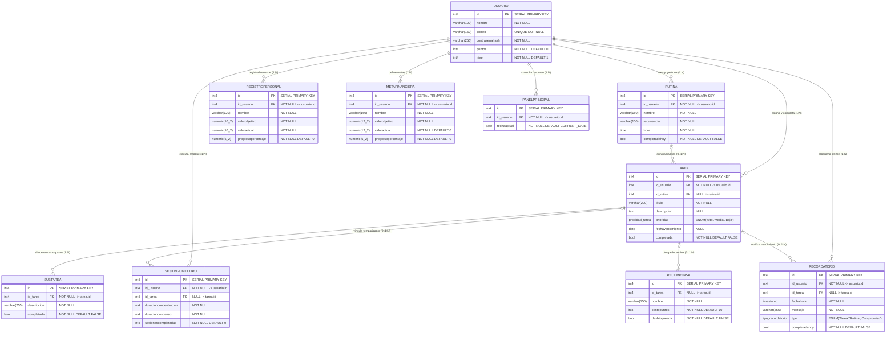

# Arquitectura de Datos y Diagrama Entidad-Relación (PostgreSQL) — Proyecto DOPA

> **Agente Responsable:** `3.1. Agente Arquitecto de Datos (Database & ORM Agent)`  
> **Fuente de Verdad:** `PLANEACIÓN Y DISEÑO DE SOFTWARE (1).pdf` — Sección 4.3 (Páginas 50-56) y `Parcial 2.pdf`

---

## 1. Diagrama Entidad-Relación (Mermaid.js)

El esquema relacional consta exactamente de **10 tablas** y **2 tipos `ENUM` personalizados** en PostgreSQL (`prioridad_tarea` y `tipo_recordatorio`), manteniendo total fidelidad con los nombres de tablas y columnas definidos en el documento de Planeación y Diseño.

---

## 2. Tipos Enumerados (`ENUM`) en PostgreSQL

| Tipo PostgreSQL | Valores Permitidos | Tabla y Columna Destino | Requerimiento Asociado |
| :--- | :--- | :--- | :--- |
| `prioridad_tarea` | `'Alta'`, `'Media'`, `'Baja'` | `tarea.prioridad` | `RF-03`, `HU-02` |
| `tipo_recordatorio` | `'Tarea'`, `'Rutina'`, `'Compromiso'` | `recordatorio.tipo` | `RF-08`, `HU-05` |

---

## 3. Reglas de Integridad Referencial y Normalización (3FN)

1. **Eliminación en Cascada (`ON DELETE CASCADE`)**:
   - Cuando se elimina un `usuario`, se eliminan sus registros dependientes (`rutina`, `tarea`, `sesionpomodoro`, `recordatorio`, `registropersonal`, `metafinanciera`, `panelprincipal`).
   - Cuando se elimina una `tarea`, se eliminan automáticamente todas sus `subtarea` (micro-pasos) y sus `recordatorio` asociados.
2. **Desvinculación Segura (`ON DELETE SET NULL`)**:
   - Si se elimina una `rutina`, las tareas asociadas (`tarea.id_rutina`) permanecen en el sistema como tareas independientes (`id_rutina = NULL`).
   - Si se elimina una `tarea`, el historial de `sesionpomodoro` y las `recompensa` desbloqueadas conservan su validez histórica poniendo `id_tarea = NULL`, protegiendo los puntos y logros del usuario (`RF-16`, gamificación libre de culpa).
3. **Restricciones de Dominio (`CHECK`)**:
   - `usuario.puntos >= 0` y `usuario.nivel >= 1`: garantiza a nivel de motor de base de datos que jamás se resten puntos por debajo de cero ni se degrade el nivel del usuario (`HU-11`, `RF-16`).

---

## 4. Estrategia de Indexación y Rendimiento (`RNF-04` y `RNF-17`)

- `idx_usuario_correo`: Acelera el inicio de sesión (`POST /api/v1/auth/login`) en tiempo $O(\log n)$.
- `idx_tarea_usuario_estado_prioridad`: Índice compuesto sobre `(id_usuario, completada, prioridad)` para alimentar instantáneamente el Dashboard (`GET /api/v1/dashboard`) y el botón *"¡Hacer algo fácil!"* (`GET /api/v1/dashboard/quick-task`).
- `idx_subtarea_tarea`: Optimiza la carga de micro-pasos (`GET /api/v1/tasks/{id}`) para la pantalla *"Enfoque suave"*.
- `idx_recordatorio_usuario_fechahora`: Optimiza la consulta de próximas alertas activas ordenadas cronológicamente.
- `idx_panelprincipal_usuario_fecha`: Optimiza la consulta y actualización del snapshot diario del panel principal.
