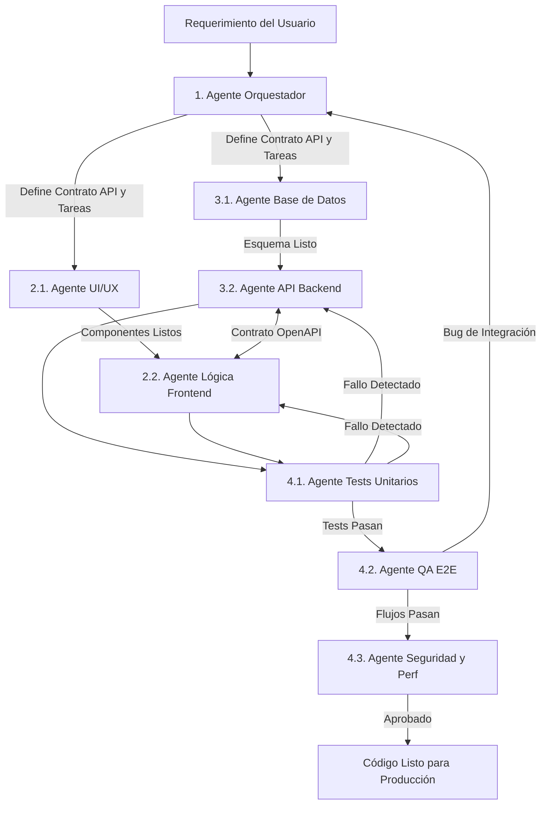

# Stack de Agentes IA para Desarrollo de Software (Front, Back & QA)

Esta arquitectura define un ecosistema multi-agente diseñado para automatizar, asistir y acelerar el ciclo de vida del desarrollo de software (SDLC). Cada agente tiene un rol específico, un conjunto de herramientas asignadas y protocolos de comunicación claros.

---

## 1. Agente Orquestador (Tech Lead / Product Manager Agent)
Es el punto de entrada del sistema. Recibe los requerimientos del usuario y coordina el trabajo entre los agentes de Frontend, Backend y QA.

* **Rol Principal:** Analizar requerimientos, dividir tareas, definir contratos de datos (APIs) y validar entregas parciales.
* **Responsabilidades:**
  * Traducir historias de usuario en tareas técnicas para Front y Back.
  * Definir el esquema de comunicación (contratos OpenAPI / GraphQL) antes de que empiece la codificación.
  * Resolver bloqueos y gestionar el contexto global del proyecto.
* **Prompts / Reglas Clave:** *"Nunca permitas que el Frontend o el Backend comiencen a programar sin antes haber acordado y documentado el contrato de la API."*

---

## 2. Stack de Agentes de Frontend

### 2.1. Agente de UI/UX & Maquetación (UI Builder Agent)
* **Rol Principal:** Traducir diseños o descripciones en componentes visuales accesibles y responsivos.
* **Tecnologías recomendadas:** React / Next.js, Vue, Tailwind CSS, Shadcn/UI, HTML5 semántico.
* **Responsabilidades:**
  * Crear componentes atómicos y pantallas completas.
  * Asegurar el cumplimiento de estándares de accesibilidad (WCAG / ARIA).
  * Implementar diseño responsivo (Mobile-first).
* **Entregables:** Componentes puros (presentacionales), configuración de estilos y Storybook (si aplica).

### 2.2. Agente de Lógica e Integración Frontend (Frontend State & API Agent)
* **Rol Principal:** Dotar de interactividad a los componentes y conectarlos con el Backend.
* **Tecnologías recomendadas:** TypeScript, Zustand / Redux, React Query / TanStack, Axios / Fetch.
* **Responsabilidades:**
  * Gestionar el estado local y global de la aplicación.
  * Consumir los endpoints definidos en el contrato de la API.
  * Manejar estados de carga (*loading*), errores (*error boundaries*) y validación de formularios (Zod + React Hook Form).
* **Entregables:** Custom Hooks, servicios de conexión a API, flujos de autenticación en cliente.

---

## 3. Stack de Agentes de Backend

### 3.1. Agente Arquitecto de Datos (Database & ORM Agent)
* **Rol Principal:** Diseñar, optimizar y mantener el modelo de datos.
* **Tecnologías recomendadas:** PostgreSQL, MongoDB, Redis, Prisma / TypeORM / SQLAlchemy.
* **Responsabilidades:**
  * Crear esquemas de bases de datos relacionales o NoSQL.
  * Generar archivos de migración y *seeders* (datos de prueba).
  * Optimizar consultas mediante índices y buenas prácticas de normalización.
* **Entregables:** Archivos `schema.prisma` o scripts SQL, diagramas entidad-relación (Mermaid.js).

### 3.2. Agente de API y Lógica de Negocio (Backend Core Agent)
* **Rol Principal:** Construir los servicios, controladores y reglas de negocio del servidor.
* **Tecnologías recomendadas:** Node.js (NestJS / Express), Python (FastAPI / Django), Go.
* **Responsabilidades:**
  * Implementar endpoints RESTful o GraphQL siguiendo el contrato del Orquestador.
  * Implementar autenticación y autorización (JWT, OAuth2, RBAC).
  * Validar datos de entrada (DTOs) y manejar errores de forma centralizada.
  * Integrar servicios de terceros (pasarelas de pago, envío de correos, etc.).
* **Entregables:** Controladores, servicios, middlewares y documentación Swagger/OpenAPI actualizada.

---

## 4. Stack de Agentes de QA (Quality Assurance)

### 4.1. Agente de Pruebas Unitarias e Integración (Code Tester Agent)
* **Rol Principal:** Garantizar que las funciones individuales y los módulos funcionen correctamente de forma aislada.
* **Tecnologías recomendadas:** Jest, Vitest, PyTest, Supertest, React Testing Library.
* **Responsabilidades:**
  * Escribir tests unitarios para funciones de utilidad, servicios de Backend y componentes de Frontend.
  * Crear mocks de bases de datos y servicios externos.
  * Asegurar un porcentaje mínimo de cobertura de código (*Code Coverage* > 80%).
* **Entregables:** Archivos `*.spec.ts` o `*.test.js` ejecutables en el pipeline de CI.

### 4.2. Agente de Automatización E2E (End-to-End QA Agent)
* **Rol Principal:** Simular el comportamiento de un usuario real interactuando con toda la aplicación integrada.
* **Tecnologías recomendadas:** Playwright, Cypress.
* **Responsabilidades:**
  * Diseñar y programar flujos críticos de usuario (ej. Registro -> Login -> Compra -> Checkout).
  * Ejecutar pruebas en múltiples navegadores y resoluciones.
  * Capturar trazas, capturas de pantalla y logs de red cuando ocurre un fallo.
* **Entregables:** Suite de pruebas E2E y reportes de fallos detallados para los agentes de Front y Back.

### 4.3. Agente de Seguridad y Rendimiento (SecOps & Perf Agent)
* **Rol Principal:** Auditar el código en busca de vulnerabilidades y cuellos de botella.
* **Tecnologías recomendadas:** OWASP ZAP, SonarQube, k6 (pruebas de carga), Lighthouse.
* **Responsabilidades:**
  * Revisar el código en busca de inyecciones SQL, XSS, exposición de datos sensibles o dependencias vulnerables.
  * Ejecutar pruebas de estrés en los endpoints del Backend.
  * Auditar métricas Core Web Vitals en el Frontend.
* **Entregables:** Reporte de vulnerabilidades y sugerencias de refactorización directa.

---

## 5. Flujo de Trabajo Colaborativo (Pipeline de Ejecución)

Para implementar este stack en herramientas como **CrewAI, AutoGen o LangGraph**, se sugiere el siguiente flujo secuencial y cíclico:

---

## 6. Herramientas (Tools) Recomendadas para Conectar a los Agentes

Para que estos agentes sean autónomos, deben tener acceso a las siguientes capacidades (vía MCP - *Model Context Protocol* o Function Calling):

1. **File System Tool:** Leer, crear y modificar archivos dentro del repositorio local.
2. **Terminal / Bash Tool:** Ejecutar comandos para instalar paquetes (`npm`, `pip`), correr compiladores y ejecutar suites de pruebas (`npx playwright test`, `npm test`).
3. **Git Tool:** Crear ramas, hacer *commits* atómicos y abrir *Pull Requests*.
4. **Browser Tool (Headless):** Permitir a los agentes de Frontend y QA inspeccionar el DOM renderizado y leer la consola del navegador en tiempo real.