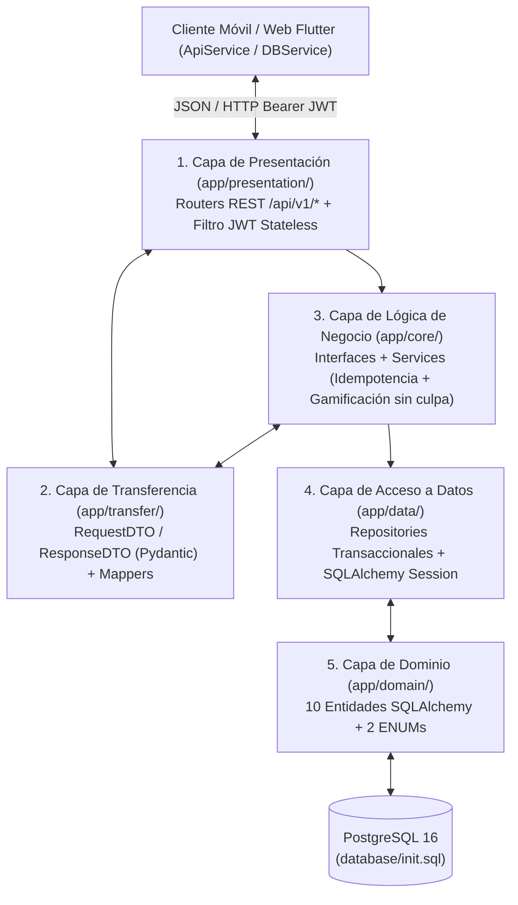

# Documentación de Arquitectura y Estructura del Proyecto — DOPA (TDAH)

> **Proyecto:** DOPA — Aplicación Móvil y Web de Gestión, Enfoque Suave y Bienestar para Personas con TDAH  
> **Lema UX:** *"Vamos un paso a la vez"* · *"Poquito a poquito"*  
> **Arquitectura:** Cliente-Servidor Unificada (Flutter Móvil/Web + FastAPI 5 Capas + PostgreSQL 16 + Docker Multi-Stage)

---

## 1. Visión General del Sistema

**DOPA** es una solución tecnológica diseñada específicamente para reducir la sobrecarga cognitiva, la parálisis por análisis y la fricción ejecutiva en personas con TDAH. A diferencia de los gestores de tareas tradicionales que castigan las rachas rotas, DOPA implementa:

1. **Desglose en Micro-pasos (`subtarea`):** Divide tareas complejas en acciones atómicas de 1 a 2 minutos.
2. **Enfoque Suave (`sesionpomodoro`):** Temporizadores cortos (5 a 25 minutos) y pausas guiadas de bajo estímulo (*Respiración 4–4*, *Estiramiento suave*).
3. **Gamificación Libre de Culpa (`recompensa`, `usuario`):** Otorga puntos de dopamina (`+10` por tarea, `+5` por sesión Pomodoro) de manera **idempotente** y **nunca resta puntos ni niveles por días de inactividad** (`RF-16`, `HU-11`).
4. **Seguimiento de Bienestar y Metas (`registropersonal`, `metafinanciera`):** Registro diario de energía (*poquita*, *media*, *a tope*), humor (*Abrumado*, *Inquieto*, *Con foco*, *Tranquilo*), horas de sueño y metas de ahorro personal.

---

## 2. Árbol Unificado de Directorios y Archivos (`dopa/`)

Todo el ecosistema (Frontend Flutter, Backend FastAPI, Base de Datos PostgreSQL, Suite de Pruebas QA y Contenedorización Docker) se encuentra unificado en la carpeta raíz **`dopa/`**:

```text
dopa/
├── app/                                      # BACKEND: API RESTful en Python + FastAPI (5 Capas)
│   ├── main.py                               # Punto de entrada FastAPI, CORS, /health y registro de routers
│   ├── presentation/                         # Capa 1: Presentación (Controladores REST y Seguridad JWT)
│   │   ├── dependencies.py                   # Middleware Bearer JWT Stateless e Idempotency-Key
│   │   └── routers/                          # 9 Controladores versionados bajo /api/v1/*
│   │       ├── auth.py                       # /api/v1/auth (register, login, refresh, logout, me, preferences)
│   │       ├── dashboard.py                  # /api/v1/dashboard (resumen diario, energy-checkin, quick-task)
│   │       ├── tasks.py                      # /api/v1/tasks (CRUD tareas, complete idempotente, subtareas)
│   │       ├── routines.py                   # /api/v1/routines (CRUD rutinas, complete-today, resume sin culpa)
│   │       ├── pomodoro.py                   # /api/v1/pomodoro (sessions, complete, cancel, low-stimulus)
│   │       ├── reminders.py                  # /api/v1/reminders (alertas de Tarea, Rutina y Compromiso)
│   │       ├── gamification.py               # /api/v1/gamification (summary de dopamina y rewards)
│   │       ├── personal_records.py           # /api/v1/personal-records (sueño, humor y energía)
│   │       └── financial_goals.py            # /api/v1/financial-goals (metas de ahorro y avance %)
│   ├── transfer/                             # Capa 2: Transferencia de Datos y Mapeo
│   │   ├── dtos.py                           # RequestDTO y ResponseDTO con validaciones Pydantic v2
│   │   └── mappers.py                        # Conversión bidireccional segura Entity <-> DTO
│   ├── core/                                 # Capa 3: Lógica de Negocio y Reglas de Dominio
│   │   ├── interfaces.py                     # Contratos abstractos de servicios (Principio DIP - SOLID)
│   │   ├── services.py                       # Implementación de negocio, idempotencia y gamificación
│   │   └── security.py                       # Hashing bcrypt (12 rondas) y firma/validación JWT (HS256)
│   ├── data/                                 # Capa 4: Acceso a Datos y Persistencia
│   │   ├── database.py                       # Engine SQLAlchemy (PostgreSQL en prod / SQLite en tests)
│   │   └── repositories.py                   # Repositorios transaccionales ACID con paginación
│   └── domain/                               # Capa 5: Dominio (Entidades Relacionales)
│       └── models.py                         # 10 Entidades SQLAlchemy y 2 tipos ENUM
│
├── database/                                 # BASE DE DATOS: PostgreSQL 16
│   ├── init.sql                              # DDL de 10 tablas, 2 ENUMs, 14 índices y Seeders (Fred y Paula)
│   └── ER_DIAGRAM.md                         # Diagrama Entidad-Relación (Mermaid) y diccionario de datos
│
├── lib/                                      # FRONTEND: Aplicación Móvil (Android/iOS) y Web en Flutter
│   ├── main.dart                             # Punto de entrada Flutter, tema visual y marco adaptable móvil
│   ├── models/                               # Modelos de datos con mapeo JSON hacia FastAPI
│   │   ├── user_model.dart                   # Usuario (puntos, meta diaria, nivel, energía)
│   │   ├── task_model.dart                   # TareaBloque y MicroPaso (sincronizados con TaskResponseDTO)
│   │   ├── focus_session_model.dart          # SesionEnfoque (vinculado a SesionPomodoro)
│   │   ├── wellness_record_model.dart        # RegistroBienestar y TipoHumor
│   │   └── reward_model.dart                 # Recompensa (insignias y puntos de dopamina)
│   ├── services/                             # Capa de Integración HTTP y Persistencia Híbrida
│   │   ├── api_service.dart                  # Cliente HTTP unificado para todos los endpoints /api/v1/*
│   │   └── db_service.dart                   # Servicio híbrido (FastAPI REST + Caché Offline-First)
│   ├── screens/                              # Pantallas Principales de Baja Fricción Cognitiva
│   │   ├── main_navigation_screen.dart       # Navegación inferior entre las 4 secciones principales
│   │   ├── home_dashboard_screen.dart        # Pantalla 1: Inicio ("¡Hola, Fred!", Energía y Micro-tarea)
│   │   ├── tasks_screen.dart                 # Pantalla 2: Mis tareas ("Poquito a poquito" + IA)
│   │   ├── soft_focus_screen.dart            # Pantalla 3: Enfoque suave (Pomodoro 05:00 + Micro-pasos)
│   │   ├── session_success_screen.dart       # Pantalla 4: Celebración libre de culpa ("¡Lo hiciste!")
│   │   ├── dopamine_stats_screen.dart        # Pantalla 5: Mi Dopamina hoy (Meta, Humor y Rachas)
│   │   └── gentle_break_screen.dart          # Pantalla 6: Un break suave (Respiración 4-4 y Estiramiento)
│   ├── widgets/                              # Componentes UI modulares Neo-Brutalist Pastel
│   │   ├── ai_recommendation_card.dart       # Tarjeta de recomendación adaptativa conectada al backend
│   │   ├── bottom_nav_bar.dart               # Barra de navegación inferior accesible
│   │   ├── dopa_card.dart                    # Contenedor base con bordes definidos y estética suave
│   │   ├── energy_bar.dart                   # Medidor visual de energía y dopamina
│   │   ├── mood_selector.dart                # Selector interactivo de estado de ánimo
│   │   ├── streak_chart.dart                 # Gráfico semanal de rachas libre de culpa
│   │   └── task_item_tile.dart               # Tarjeta de tarea con estados ('ahora', 'después', 'hecho')
│   └── theme/
│       └── app_theme.dart                    # Design Tokens, paleta pastel de bajo estímulo y tipografía
│
├── android/                                  # Plataforma nativa Android (con permisos INTERNET y Cleartext)
├── ios/                                      # Plataforma nativa iOS (Xcode Runner)
├── web/                                      # Plataforma Web / PWA (manifest.json, index.html, íconos)
│
├── tests/                                    # TESTING BACKEND (PyTest - 30 tests, 99% cobertura)
│   ├── conftest.py                           # Fixtures aisladas con SQLite in-memory por prueba
│   ├── test_unit_services_and_mappers.py     # Pruebas unitarias de servicios, mappers y cálculo de %
│   ├── test_api_endpoints.py                 # Pruebas de integración de los 9 módulos REST (/api/v1/*)
│   ├── test_e2e_user_flows.py                # Flujos E2E completos de usuario (Fred y Paula)
│   └── test_security_and_perf.py             # Auditoría OWASP, JWT, bcrypt, aislamiento BOLA y latencia
│
├── test/                                     # TESTING FRONTEND (Flutter Test - Widgets + API MockClient)
│   └── widget_test.dart                      # Pruebas de UI móvil y contrato HTTP con todos los endpoints
│
├── docs/                                     # DOCUMENTACIÓN TÉCNICA Y CERTIFICACIONES
│   ├── API_CONTRACT.md                       # Especificación detallada de todos los endpoints /api/v1
│   └── QA_SECURITY_REPORT.md                 # Reporte de calidad QA y auditoría SecOps
│
├── Dockerfile                                # Dockerfile Multi-Stage Unificado (targets: backend y frontend)
├── docker-compose.yml                        # Orquestación completa (db, pgadmin, backend, frontend)
├── nginx.conf                                # Servidor SPA + Reverse Proxy (/api/ -> backend:8000)
├── requirements.txt                          # Dependencias de Python (FastAPI, SQLAlchemy, PyTest, etc.)
├── pubspec.yaml                              # Dependencias de Flutter/Dart (flutter, http, flutter_test)
├── .env.example                              # Plantilla unificada de variables de entorno
├── AGENTS.md                                 # Configuración activa de agentes para el workspace
├── framework_multi_agente_para_sdlc.md       # Especificación del Framework Multi-Agente SDLC
├── stack_de_agentes_de_desarrollo_front_back_qa.md # Stack de agentes Front, Back y QA
├── ESTRUCTURA_DEL_PROYECTO.md                # Este documento de arquitectura y estructura
└── GUIA_INICIO_Y_DESPLIEGUE.md               # Manual de inicio local, ejecución en celular y despliegue
```

---

## 3. Arquitectura del Backend en 5 Capas (`app/`)

El servidor sigue la **Arquitectura en 5 Capas** con separación estricta de responsabilidades (principios **SOLID**):



---

## 4. Esquema Relacional de Base de Datos (`database/init.sql`)

La base de datos PostgreSQL implementa **10 tablas normalizadas**, **2 tipos `ENUM`** (`prioridad_tarea`, `tipo_recordatorio`) y **14 índices de rendimiento**:

| # | Tabla PostgreSQL | Entidad SQLAlchemy | Propósito en DOPA |
| :- | :--- | :--- | :--- |
| 1 | `usuario` | `Usuario` | Perfil del usuario, `correo` único, `contrasenahash` (bcrypt), `puntos` y `nivel`. |
| 2 | `rutina` | `Rutina` | Hábitos recurrentes libres de culpa (`recurrencia`, `hora`, `completadahoy`). |
| 3 | `tarea` | `Tarea` | Tareas principales con `prioridad` (`Alta`, `Media`, `Baja`) y `fechavencimiento`. |
| 4 | `subtarea` | `Subtarea` | Micro-pasos asociados a una tarea (`ON DELETE CASCADE`) para evitar parálisis. |
| 5 | `sesionpomodoro` | `SesionPomodoro` | Bloques cortos de concentración y descanso suave con conteo de ciclos. |
| 6 | `recordatorio` | `Recordatorio` | Alertas programadas clasificadas en `Tarea`, `Rutina` o `Compromiso`. |
| 7 | `recompensa` | `Recompensa` | Logros e insignias desbloqueables con puntos de dopamina. |
| 8 | `registropersonal` | `RegistroPersonal` | Métricas de sueño, humor y energía con autocalculado de `progresoporcentaje`. |
| 9 | `metafinanciera` | `MetaFinanciera` | Metas de ahorro personal con cálculo automático de porcentaje de avance. |
| 10 | `panelprincipal` | `PanelPrincipal` | Snapshot diario del Dashboard principal por usuario. |

---

## 5. Integración Unificada Frontend ↔ Backend (`/api/v1`)

La comunicación entre las pantallas de Flutter (`lib/screens/*`) y el backend FastAPI (`app/presentation/routers/*`) se realiza a través de [`ApiService`](file:///c:/Users/Santiago%20Orjuela/Documents/Proyecto/dopa/lib/services/api_service.dart) y [`DBService`](file:///c:/Users/Santiago%20Orjuela/Documents/Proyecto/dopa/lib/services/db_service.dart):

| Pantalla / Componente Flutter | Servicio Invocado | Endpoint FastAPI Conectado | Método HTTP |
| :--- | :--- | :--- | :--- |
| **Inicio (`HomeDashboardScreen`)** | `ApiService.getDashboard()` / `DBService.getUsuario()` | `/api/v1/dashboard` | `GET` |
| **Chequeo de Energía / Humor** | `ApiService.energyCheckin()` | `/api/v1/dashboard/energy-checkin` | `POST` |
| **Botón "¡Hacer algo fácil!"** | `ApiService.getQuickTask()` | `/api/v1/dashboard/quick-task` | `GET` |
| **Mis Tareas (`TasksScreen`)** | `DBService.obtenerTareas()` | `/api/v1/tasks` | `GET` |
| **Completar Tarea (`+10 dopamina`)** | `DBService.actualizarTarea()` | `/api/v1/tasks/{task_id}/complete` | `POST` (con `Idempotency-Key`) |
| **Enfoque Suave (`SoftFocusScreen`)** | `DBService.actualizarMicroPaso()` | `/api/v1/tasks/{task_id}/subtasks/{subtask_id}` | `PATCH` |
| **Temporizador Pomodoro** | `DBService.registrarSesion()` | `/api/v1/pomodoro/sessions` y `/complete` | `POST` |
| **Un Break Suave (`GentleBreakScreen`)**| `ApiService.getLowStimulusActivities()` | `/api/v1/pomodoro/low-stimulus-activities` | `GET` |
| **Mi Dopamina Hoy (`DopamineStatsScreen`)**| `DBService.obtenerTotalDopaminaHoy()` | `/api/v1/gamification/summary` | `GET` |
| **Recompensas (`SessionSuccessScreen`)**| `DBService.agregarRecompensa()` | `/api/v1/gamification/rewards` | `POST` |
| **Diario de Bienestar (`MoodSelector`)**| `DBService.guardarRegistroBienestar()` | `/api/v1/personal-records` | `POST` |
| **Metas Financieras y Rutinas** | `ApiService.listFinancialGoals()` / `listRoutines()` | `/api/v1/financial-goals` y `/api/v1/routines` | `GET / POST / PATCH` |
